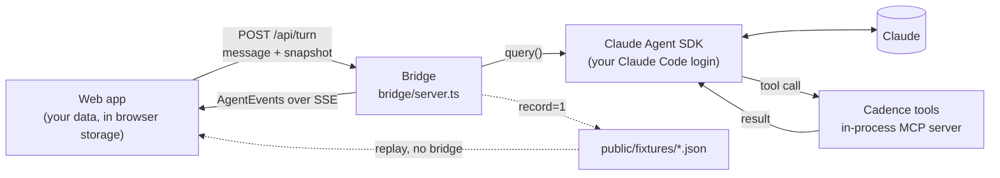

# Cadence

**Your week, in step with your cycle.**

Cadence is a local web app that helps you plan your week around how you actually feel across your menstrual cycle. It estimates where you are in your cycle, keeps a 10-second daily check-in, and has a Guide: a Claude agent that reads your calendar, habits, and check-ins and suggests changes. The agent never changes anything by itself. Every change it wants to make arrives as a suggestion with a before and after, and only the ones you approve take effect. You can undo those too.

Cadence was built for a Purdue CS 110 capstone. It runs on your own computer, uses your existing Claude Code login, and stores your data only in your browser.

## Run it

You need:

- Node.js 20.19 or newer.
- Claude Code, installed and signed in. Run `claude` once in a terminal and log in. Cadence's agent runs on that login, so you need no API key.

From the project folder:

```sh
npm install
npm run dev
```

Open <http://localhost:5173>. `npm run dev` starts two processes:

- `web`: the Vite dev server for the app, on port 5173.
- `bridge`: a small Node server that runs the agent, on port 8741. The web app reaches it through `/api`.

The status pill at the top right says **Agent ready** when the bridge is up. If port 8741 is taken, pick another one: `CADENCE_BRIDGE_PORT=8742 npm run dev`.

The first screen asks for your cycle basics, explains what Cadence does with your data, and offers a sample week or a blank start. The sample week is the quickest way to try the Guide.

## Run the demo flows

Each demo flow loads fixed data on a fixed day, so it looks the same every time. Add `?demo=<flow>` to the URL. The page resets to the demo data on every load.

| Flow | URL | Day it simulates |
| --- | --- | --- |
| Plan my week | <http://localhost:5173/?demo=plan-week#/today> | Monday, Nov 16, cycle day 25, midterm on Thursday |
| Rough morning | <http://localhost:5173/?demo=rough-morning#/today> | Thursday, Nov 19, period started today, midterm tonight |
| When to see someone | <http://localhost:5173/?demo=safety#/guide> | Saturday, Nov 21, day 3 of a period |

### Replay mode (default)

With only `?demo=<flow>`, the Guide replays a session recorded from the real model, with its original timing. It needs no bridge and no network. To run the app without the bridge at all, start only the web server with `npm run dev:web`.

These URL parameters shape a replay:

- `speed=2` plays twice as fast. Any positive number works.
- `gap=3` caps every pause, such as the model thinking, at 3 seconds. Event order stays the same.
- `theme=dark` or `theme=light` forces a theme.
- `keep=1` keeps changes across reloads instead of resetting to the demo data.

### Steps for each flow

**Plan my week.**

1. Open the plan-week URL. Today shows the cycle dial sweeping to day 25.
2. Open **Guide** and click **Plan my week around my cycle.**
3. Watch the agent read your cycle, calendar, habits, and check-ins, then send a set of suggestions.
4. Approve most of them, decline one, and click **Undo** on one you approved.
5. Open **Plan**. Approved changes are on the calendar, and anything still pending shows as a dashed ghost block.

**Rough morning.**

1. Open the rough-morning URL.
2. In **How are you, really?**, pick Energy **Low**, Mood **Flat**, tap **cramps**, and click **Save check-in**.
3. Open **Guide** and click **Today feels rough, what should I change?**
4. The agent suggests a few small changes for today only. Approve the ones you like.

**When to see someone.**

1. Open the safety URL.
2. Click the prompt about bad cramps. The agent says plainly that this is worth seeing a clinician about, without diagnosing anything.
3. Click **Yes please, help me get ready for the appointment.** The agent drafts notes for the appointment from the check-ins.

### Live mode

Add `live=1` to send the same demo turns to the real bridge and model, for example <http://localhost:5173/?demo=plan-week&live=1#/guide>. Without `?demo`, the app is always live and uses your own data.

The model is Claude Opus 5.5 by default. You can switch to Claude Sonnet 5.5 in **Settings**.

### Record a new session

Add `record=1` to a live demo URL, and the bridge saves each finished turn to `public/fixtures/<flow>.json`. The recording script does this end to end. It drives each flow in a headless browser and checks the approval rules as it goes:

```sh
npm run dev                         # in one terminal
npm run record                      # record all three flows
npm run record -- safety            # record one flow
npm run record -- --replay          # replay all fixtures with every /api request blocked
```

`npm run record` fails if any check fails. It checks that nothing changes before you approve, that declining changes nothing, that approving applies the change, and that undo reverts it.

## How the agent works

An agent is a language model that can call tools in a loop. Cadence's agent is Claude, run through the [Claude Agent SDK](https://github.com/anthropics/claude-agent-sdk-python), which is the Claude Code agent loop packaged as a library. The bridge uses the TypeScript version.



One turn goes like this:

1. You send a message. The app sends it to the bridge with a snapshot of the data the agent may read: your cycle details, a few weeks of calendar, your habits, and recent check-ins.
2. The bridge starts an Agent SDK session with Cadence's system prompt and six custom tools, served from an in-process MCP server. Every built-in Claude Code tool is turned off (`tools: []`), so the agent has no shell, no files, and no web. Settings files, `CLAUDE.md`, and other MCP servers are not loaded.
3. Claude calls tools. Read tools answer from the snapshot. The two writing tools only draft a `Proposal`. Neither tool changes your data, and the bridge has no way to write to it.
4. The bridge turns the SDK's messages into a stream of typed `AgentEvent`s (text, tool started, tool finished, proposal created, done, error) and sends them to the app over server-sent events.
5. The app folds each event into the conversation with one reducer, `reduceAgentEvent`. A replayed fixture produces the same events and goes through the same code.
6. You approve or decline each suggestion. Approval runs the change through `applyChange`, the same reducer the rest of the app uses, and records the inverse so you can undo it.

The session itself is stateless. Earlier turns of the conversation travel with each message as text, so the bridge stores nothing.

### Tools

| Tool | Kind | What it returns |
| --- | --- | --- |
| `get_cycle_status` | Read | Today's estimated cycle day and phase, confidence, predicted windows as date ranges, and the next 14 days |
| `list_events` | Read | Events in a date range with id, time, kind, fixed or movable, load, and estimated phase |
| `list_habits` | Read | Habits, their schedules, and any phase versions |
| `get_check_ins` | Read | Recent energy, mood, symptoms, and notes, plus patterns by phase from the user's own logs |
| `propose_changes` | Suggest | Drafts calendar or habit changes (move, edit, add, or remove an event; add or update a habit) |
| `log_check_in` | Suggest | Drafts a check-in from what the user said in the chat |

Tool inputs are validated with zod schemas in `src/agent/schemas.ts`. The handlers in `src/agent/tools.ts` are pure functions of the snapshot, so you can test them without the SDK.

### Safety rules

These rules are enforced in code:

- The agent can only reach Cadence's six tools. Built-in tools are disabled and only those six are allowed (`permissionMode: 'dontAsk'`).
- No tool writes user data. `propose_changes` checks a draft by applying it to a scratch copy and returns a proposal for the user. The bridge never applies anything.
- Fixed events (classes, exams, shifts, deadlines) cannot be moved, edited, or removed. Suggestions cannot start in the past or overlap another event. A rejected draft goes back to the model with the reason, and the model fixes it.
- A drafted check-in needs both energy and mood. If the user did not say one, the tool tells the model to ask rather than guess.
- Only an approval applies a change, and only through `applyChange`. A suggestion whose "before" no longer matches the calendar is marked out of date instead of being applied.

These rules live in the system prompt (`src/agent/systemPrompt.ts`). **Settings** shows the prompt word for word:

- Your phase does not change what you are capable of. The agent plans around what you log about how you feel and treats the phase as a hint. It never says a phase lowers ability, focus, or judgment.
- It frames suggestions as experiments and cites your own check-ins.
- It does not diagnose and gives no medication advice.
- It recommends a clinician, clearly and kindly, for red-flag symptoms: pain that stops you doing things, very heavy or long periods, missed periods, severe mood changes, dizziness, or fever with pain. For urgent signs it points to urgent care. If someone mentions self-harm, it points to a crisis line (988 in the US).
- Cycle predictions are estimates and never for birth control or for planning a pregnancy.

The evidence behind the app's claims is on the **Learn** screen. Each claim has a strength label and a link to its source.

## How the code is organised

The domain logic is plain TypeScript with no React in it.

| Path | Contents |
| --- | --- |
| `src/domain/cycle.ts` | `estimatePhase(profile, date)`: cycle day, phase, confidence, and predicted windows as ranges that widen with sparse, irregular, or projected history |
| `src/domain/changes.ts` | The `Change` union and `applyChange`, the only way planner data changes. Each change returns its inverse. |
| `src/domain/proposal.ts` | The proposal state machine: items go from pending to approved, declined, undone, or stale. Status is derived from the items. |
| `src/domain/agent.ts` | `AgentEvent`, fixtures, chat messages, and `reduceAgentEvent` |
| `src/domain/sample.ts` | The sample week and the three demo seeds |
| `src/agent/` | System prompt, tool schemas, tool handlers, and the prompt for each turn. The bridge and the app share these. |
| `bridge/` | The HTTP and SSE server, the Agent SDK runner, and request parsing |
| `src/app/` | App state (one reducer), persistence, the live and replay transports, and navigation |
| `src/screens/` | Onboarding, Today, Plan, Guide, Learn, and Settings |
| `src/ui/` | The cycle dial, Liquid Glass surfaces, proposal cards, and the colour palette |
| `src/content/evidence.ts` | Every claim on the Learn screen, its evidence level, and its source |
| `public/fixtures/` | The three recorded sessions |
| `scripts/` | Recording, screenshots, the contrast check, and a one-turn agent runner |

## Checks

```sh
npm run check        # typecheck, lint, unit tests, production build
npm test             # unit tests for cycle estimates, changes, proposals, and tools
npm run contrast     # every colour pairing against WCAG AA, light and dark
npm run screens      # screenshots of every screen into .audit/screens (needs npm run dev)
npx tsx scripts/try-turn.ts plan-week   # one live agent turn in the terminal
```

`npm run build` writes a static site to `dist/`, fixtures included, so replays work from `npm run preview` too. Live turns always need the bridge (`npm run bridge`).

## Your data

Everything stays in this browser's local storage. There is no account and no Cadence server. When you use the Guide, the tool results it asks for are sent to Claude through the Claude Code login on this computer so it can reply. **Settings** can export everything as JSON or delete it.

Cadence is a planning tool, not medical advice.
